# H-Task – Quản lý công việc nhóm kiểu Trello (Web + Mobile)

**H-Task** là ứng dụng **quản lý công việc** và **quản lý dự án** cho nhóm, theo phong cách Trello. Mỗi dự án là một bảng Kanban gồm nhiều danh sách. Mỗi công việc là một thẻ có thể kéo thả, giao người, đặt hạn chót và trao đổi bình luận.

Dự án gồm ba phần dùng chung một REST API:

| Phần | Công nghệ | Thư mục |
|---|---|---|
| Web | React 19 + TypeScript | [`frontend/`](./frontend) |
| App di động (Android, iOS) | Flutter | [`mobile/`](./mobile) |
| API | Laravel 12 + MySQL | [`backend/`](./backend) |

> *English:* H-Task is an open-source team task manager with a Trello-like Kanban board. It ships a React + TypeScript web app and a Flutter mobile app, both backed by a Laravel REST API and MySQL.


<p align="center">
  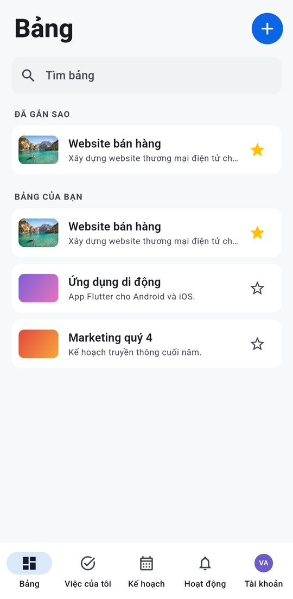
  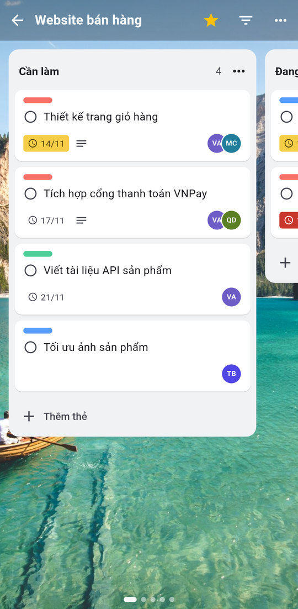
  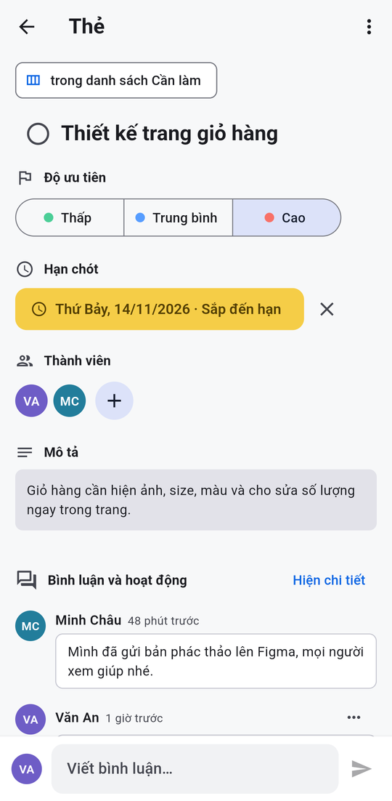
  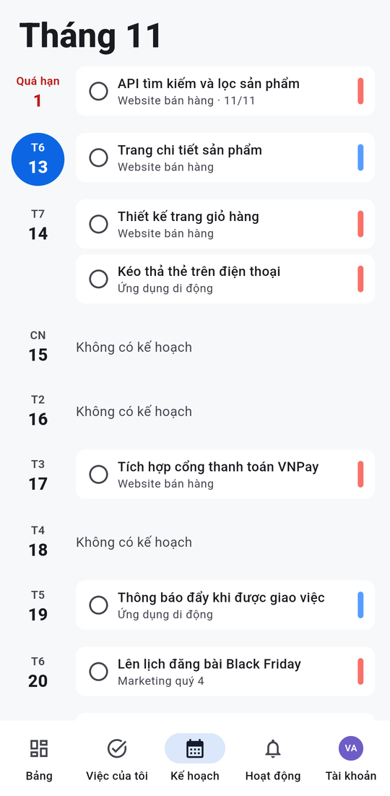
</p>

## Mục lục

- [Tính năng](#tính-năng)
- [Giao diện web](#giao-diện-web)
- [Ứng dụng di động](#ứng-dụng-di-động)
- [Công nghệ](#công-nghệ)
- [Cấu trúc thư mục](#cấu-trúc-thư-mục)
- [Cài đặt và chạy ở máy](#cài-đặt-và-chạy-ở-máy)
- [Triển khai](#triển-khai)
- [API chính](#api-chính)

## Tính năng

Bản web và app di động có cùng các tính năng dưới đây, trừ những chỗ ghi rõ.

**Bảng Kanban**
- Danh sách (cột) tuỳ chỉnh: thêm, đổi tên, xoá, sắp xếp lại.
- Kéo thả thẻ giữa các danh sách, thứ tự thẻ được lưu lại. Trên điện thoại, nhấn giữ thẻ để kéo, kéo tới mép màn hình để sang cột bên cạnh.
- Thêm nhanh thẻ ngay trong cột. Tick hoàn thành ngay trên thẻ.
- Lọc thẻ theo từ khoá, độ ưu tiên hoặc chỉ thẻ của mình.
- Gắn sao bảng, tìm kiếm bảng (trên web có phím tắt `/`).
- Phông nền bảng: 12 màu gradient và 31 ảnh phong cảnh có sẵn từ Unsplash. Trên web còn tìm ảnh theo chủ đề hoặc tải ảnh lên.

**Thẻ công việc**
- Tiêu đề, mô tả, độ ưu tiên, hạn chót (gỡ hạn cần xác nhận), đánh dấu hoàn thành, chuyển danh sách.
- Giao nhiều thành viên cho một thẻ.
- Bình luận và lịch sử hoạt động của thẻ hiển thị chung một dòng thời gian. Xoá bình luận cần xác nhận.

**Cộng tác**
- Mời thành viên bằng email, kể cả người **chưa có tài khoản**. Người được mời nhận thư, xác minh mã 6 số, đặt họ tên và mật khẩu là vào thẳng dự án.
- Quản lý thành viên: xem lời mời đang chờ, huỷ lời mời, gỡ thành viên (đồng thời gỡ khỏi các thẻ).
- Mọi thành viên trong dự án đều tạo, sửa và giao việc được. Chủ dự án quản lý thành viên.

**Cá nhân**
- *Việc của tôi*: mọi thẻ được giao ở tất cả dự án. App chia thành các nhóm Quá hạn · Hôm nay · Sắp tới.
- *Kế hoạch*: thẻ có hạn chót xếp theo ngày. Web hiển thị lịch tháng, app hiển thị danh sách theo ngày, việc quá hạn nằm trên cùng.
- *Tổng quan*: số việc đã xong, chưa xong, quá hạn và tiến độ từng dự án.
- Nhật ký hoạt động, hồ sơ, đổi mật khẩu, bật/tắt email nhắc hạn. App có thêm giao diện Sáng / Tối / Theo hệ thống.

**Tài khoản và thông báo**
- Đăng ký từng bước: email → mã 6 số gửi qua email → họ tên và mật khẩu → "Đang thiết lập tài khoản". Server tạo sẵn một **bảng mẫu** hướng dẫn cách dùng rồi mở thẳng bảng đó.
- Quên mật khẩu qua mã gửi về email. App có ô "Ghi nhớ đăng nhập".
- Xác thực API bằng token (Laravel Sanctum).
- Email nhắc việc sắp đến hạn gửi tự động lúc 8:00 mỗi sáng.

## Giao diện web

### Danh sách bảng và menu tài khoản

| Bảng của bạn | Menu tài khoản |
|---|---|
|  |  |

### Chi tiết thẻ


### Kế hoạch

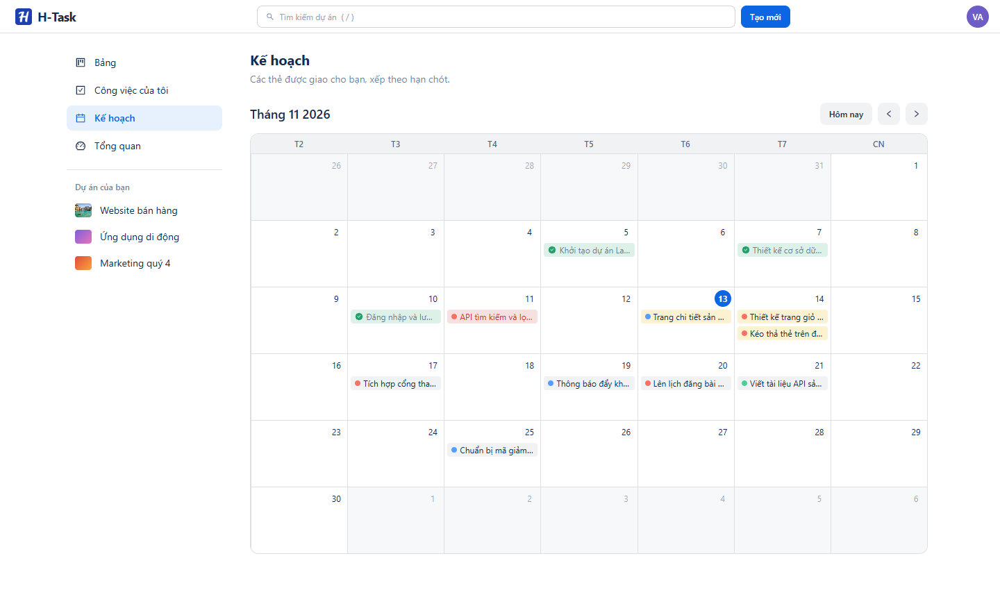

### Tạo dự án và chọn phông nền

| Tạo dự án | Ảnh nền có sẵn |
|---|---|
|  |  |

### Chia sẻ dự án và mời thành viên


| Email mời | Trang nhận lời mời |
|---|---|
|  |  |

### Công việc của tôi và Tổng quan

| Công việc của tôi | Tổng quan |
|---|---|
|  |  |

### Hoạt động và hồ sơ

| Nhật ký hoạt động | Hồ sơ |
|---|---|
|  |  |

### Đăng nhập và đăng ký

| Đăng nhập | Đăng ký – nhập email |
|---|---|
|  |  |

| Nhập mã xác minh | Họ tên và mật khẩu |
|---|---|
|  | 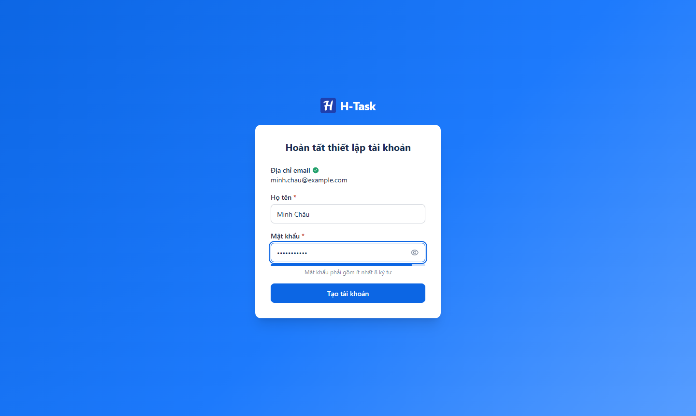 |


## Ứng dụng di động

App Flutter cho Android và iOS, gọi chung API với bản web. Thanh tab dưới gồm **Bảng · Việc của tôi · Kế hoạch · Hoạt động · Tài khoản**. Mọi thao tác (tick, kéo thẻ, sửa thẻ…) hiện kết quả ngay và tự hoàn tác nếu server báo lỗi.

| Đăng nhập | Danh sách bảng | Bảng Kanban | Chi tiết thẻ |
|:---:|:---:|:---:|:---:|
| 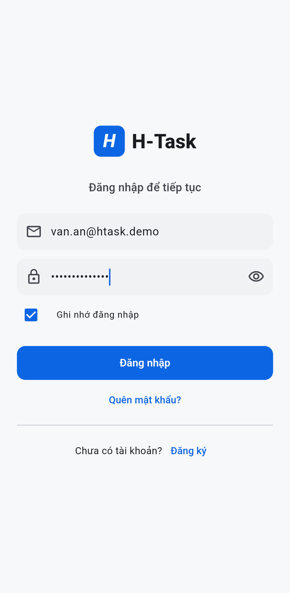 |  |  |  |

| Việc của tôi | Kế hoạch | Hoạt động | Tài khoản |
|:---:|:---:|:---:|:---:|
| 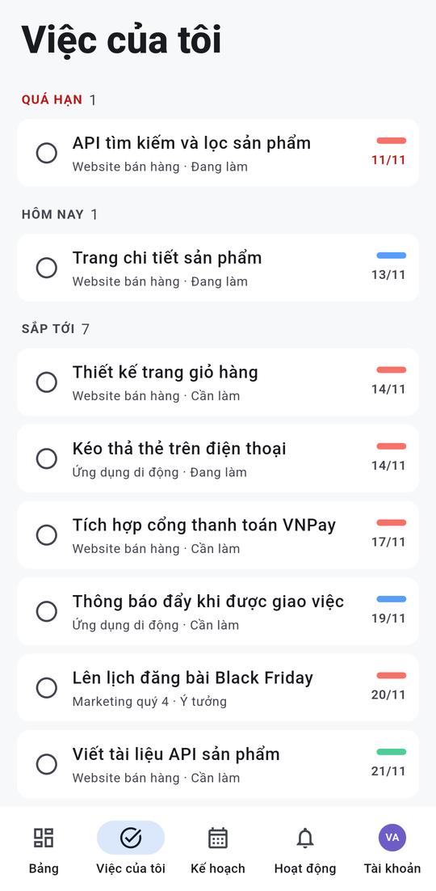 |  | 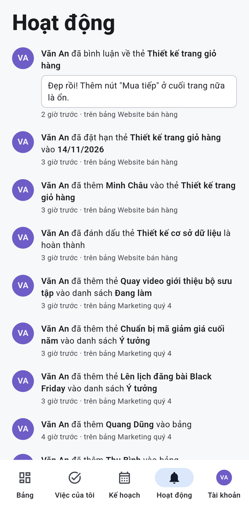 | 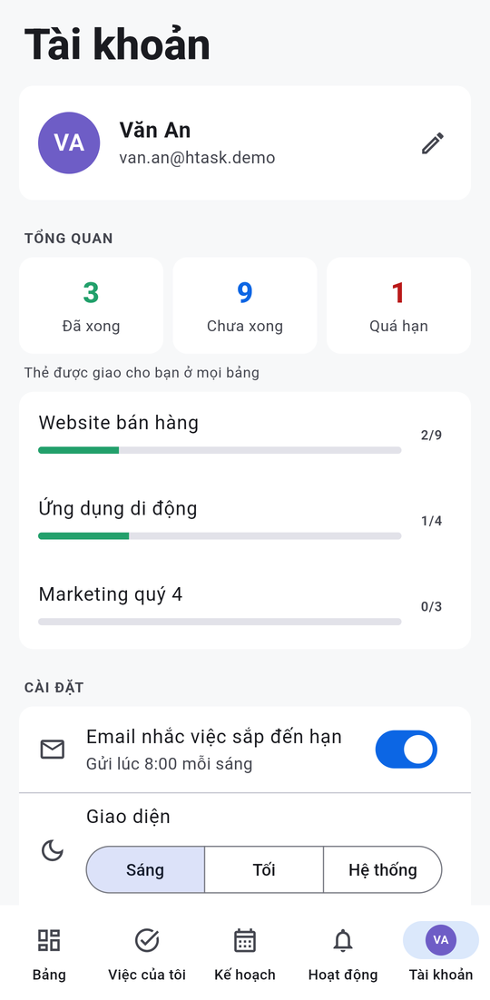 |

**Giao diện tối**

<p>
  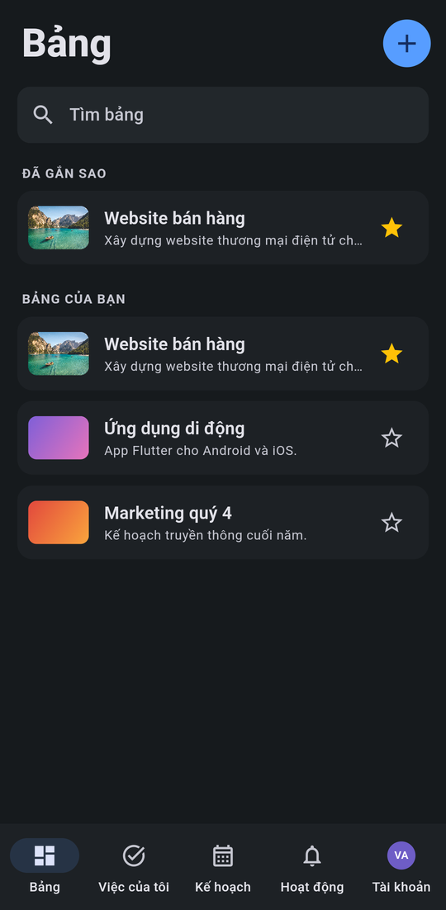
  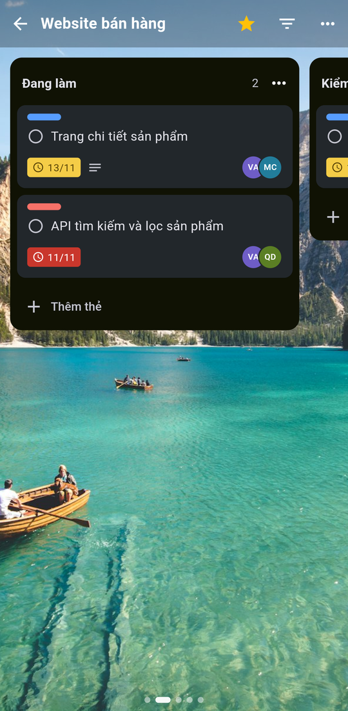
</p>

Điểm riêng của bản di động:
- Các cột vuốt ngang, mỗi lần một cột, có chấm chỉ báo vị trí.
- Kéo thả thẻ tự viết (không dùng thư viện ngoài): nhấn giữ để nhấc thẻ, rung nhẹ khi bắt đầu kéo, cột tự cuộn khi kéo gần mép.
- Mở link mời `htask://app/invite/<token>` thẳng trong app.
- Token lưu trong Keychain / Keystore. Phiên tự đăng xuất khi token hết hiệu lực.

Hướng dẫn chạy, build và lộ trình chi tiết của app nằm ở [mobile/README.md](./mobile/README.md).

## Công nghệ

| Phần | Công nghệ |
|---|---|
| Web | React 19, TypeScript, Vite 6, React Router 6, TanStack Query 5, Tailwind CSS 3 + daisyUI 5, @hello-pangea/dnd (kéo thả), Axios |
| Mobile | Flutter 3.24 (Dart 3.5), Riverpod, go_router, Dio, flutter_secure_storage, shared_preferences, cached_network_image, intl |
| Backend | Laravel 12 (PHP 8.2), Laravel Sanctum, Laravel Mail + Notifications, Task Scheduling |
| Cơ sở dữ liệu | MySQL 8 |
| Triển khai | Docker trên Render hoặc server riêng (backend), Vercel (web) |

## Cấu trúc thư mục

```
Web_QLCVN/
├── backend/                 # Laravel API
│   ├── app/Http/Controllers # Project, Task, List, Comment, Activity, Invitation, Auth/Registration...
│   ├── app/Models           # Project, TaskList, Task, Comment, Activity, ProjectInvitation...
│   ├── database/migrations
│   ├── resources/views/emails
│   ├── routes/api.php       # Định nghĩa API
│   ├── routes/console.php   # Lịch gửi email nhắc hạn
│   ├── Dockerfile           # Image cho Render
│   └── docker/entrypoint.sh
├── frontend/                # Web React + Vite
│   └── src/
│       ├── api/             # Hàm gọi API theo từng nhóm
│       ├── hooks/           # React Query hooks
│       ├── components/      # tasks/, projects/, layout/, ui/...
│       ├── pages/           # Các trang (và pages/settings)
│       └── routers/router.tsx
├── mobile/                  # App Flutter
│   ├── lib/
│   │   ├── core/            # env, api_client, theme, router
│   │   ├── models/          # user, project, task, comment, activity...
│   │   ├── widgets/
│   │   └── features/        # auth, projects, board, task, my_tasks, planner, activity, account
│   ├── test/
│   └── android/, ios/
├── deploy/                  # Docker Compose + Nginx cho server riêng
└── assets/                  # Ảnh chụp màn hình cho README (assets/mobile cho app)
```

## Cài đặt và chạy ở máy

### Yêu cầu

- PHP 8.2+ với các extension `pdo_mysql`, `mbstring`, `fileinfo`
- Composer 2
- Node.js 18+ và npm
- MySQL 8 (Laragon, XAMPP hoặc cài riêng)
- Để chạy app di động: Flutter 3.24+, Android Studio (JDK 21). Build iOS cần máy Mac có Xcode.

### Backend (Laravel)

```bash
cd backend
composer install
cp .env.example .env
php artisan key:generate
```

Sửa các biến trong `backend/.env`:

```env
DB_CONNECTION=mysql
DB_HOST=127.0.0.1
DB_PORT=3306
DB_DATABASE=task_db
DB_USERNAME=root
DB_PASSWORD=

# Gửi email (ví dụ Gmail: dùng App Password, không dùng mật khẩu đăng nhập)
MAIL_MAILER=smtp
MAIL_HOST=smtp.gmail.com
MAIL_PORT=587
MAIL_USERNAME=email_cua_ban@gmail.com
MAIL_PASSWORD=app_password
MAIL_FROM_ADDRESS=email_cua_ban@gmail.com
MAIL_FROM_NAME="H-Task"

# Địa chỉ frontend, dùng cho link trong email mời
FRONTEND_URL=http://localhost:5173
```

> Chỉ thử ở máy mà chưa muốn gửi email thật? Đặt `MAIL_MAILER=log`, mã xác minh sẽ được ghi vào `storage/logs/laravel.log`.

Tạo database `task_db` trong MySQL, rồi chạy:

```bash
php artisan migrate
php artisan storage:link      # để xem được ảnh nền tải lên
php artisan serve             # http://localhost:8000
```

Muốn gửi email nhắc hạn tự động khi chạy ở máy, mở thêm một terminal:

```bash
php artisan schedule:work
```

### Web (React)

```bash
cd frontend
npm install
```

Tạo file `frontend/.env`:

```env
VITE_API_URL=http://localhost:8000/api
```

```bash
npm run dev                   # http://localhost:5173
```

Build bản production: `npm run build` (kiểm tra kiểu TypeScript rồi build vào `dist/`).

### App di động (Flutter)

```bash
cd mobile
flutter pub get
flutter emulators --launch Pixel_8   # hoặc cắm điện thoại có bật USB debugging
flutter run                          # máy ảo Android gọi backend ở http://10.0.2.2:8000/api
```

Điện thoại thật cùng Wi-Fi: chạy backend bằng `php artisan serve --host=0.0.0.0` rồi `flutter run --dart-define=API_URL=http://<IP-máy-tính>:8000/api`. Chi tiết xem [mobile/README.md](./mobile/README.md).

## Triển khai

Web đặt trên Vercel. Backend chọn một trong hai cách:
- **Server riêng** (Ubuntu + Docker + Nginx): backend và MySQL chạy chung bằng Docker Compose. Xem hướng dẫn ở [deploy/README.md](./deploy/README.md).
- **Render**: chỉ chạy backend, MySQL đặt ở dịch vụ bên ngoài, như mô tả dưới đây.

App di động bản release gọi API qua `https://`. Đặt địa chỉ backend thật trong `mobile/lib/core/env.dart`, hoặc truyền `--dart-define=API_URL=...` khi build.

### Backend trên Render (Docker)

1. Tạo **Web Service** từ repo GitHub, chọn runtime **Docker**, **Root Directory** là `backend`.
2. Render không có MySQL, cần một MySQL bên ngoài (ví dụ Aiven, TiDB Cloud).
3. Khai báo ở **Environment**:

   | Biến | Giá trị |
   |---|---|
   | `APP_KEY` | Kết quả của `php artisan key:generate --show` |
   | `APP_URL` | `https://<tên-service>.onrender.com` |
   | `FRONTEND_URL` | Địa chỉ frontend trên Vercel |
   | `DB_CONNECTION`, `DB_HOST`, `DB_PORT`, `DB_DATABASE`, `DB_USERNAME`, `DB_PASSWORD` | Thông tin MySQL |
   | `MYSQL_ATTR_SSL_CA` | `/etc/secrets/ca.pem` nếu MySQL bắt buộc SSL (tải CA của nhà cung cấp lên mục **Secret Files** với tên `ca.pem`) |
   | `MAIL_*` | Giống cấu hình ở máy |

Khi khởi động, container tự chạy `migrate --force`, cache cấu hình và chạy lịch gửi email nhắc hạn. Đặt `RUN_MIGRATIONS=false` hoặc `RUN_SCHEDULER=false` để tắt từng phần.

> Ổ đĩa của Render gói miễn phí không lưu lâu dài: ảnh nền người dùng tải lên sẽ mất sau mỗi lần deploy. Màu nền và ảnh Unsplash có sẵn không bị ảnh hưởng.

### Web trên Vercel

1. Import repo, chọn **Root Directory** là `frontend` (framework Vite).
2. Thêm biến môi trường `VITE_API_URL=https://<tên-service>.onrender.com/api`.
3. Deploy. Mọi đường dẫn được chuyển về `index.html` để React Router xử lý.

## API chính

Tất cả endpoint có tiền tố `/api`. Trừ nhóm đăng ký/đăng nhập và lời mời, các endpoint cần header `Authorization: Bearer <token>`.

| Nhóm | Endpoint |
|---|---|
| Đăng ký | `POST /register/start` (gửi mã), `POST /register/verify-code`, `POST /register/complete` (tạo tài khoản + bảng mẫu, trả token) |
| Đăng nhập | `POST /login`, `POST /logout`, `POST /password/reset/send-code`, `POST /password/reset/verify-code`, `POST /password/reset` |
| Tài khoản | `GET /user`, `PUT /account`, `PUT /account/password`, `PUT /account/settings` |
| Dự án | `GET/POST /projects`, `GET/PUT/DELETE /projects/{id}` |
| Thành viên | `POST /projects/{id}/members`, `DELETE /projects/{id}/members/{userId}`, `DELETE /projects/{id}/invitations/{invitationId}` |
| Lời mời | `GET /invitations/{token}`, `POST /invitations/{token}/send-code`, `/verify-code`, `/accept` |
| Danh sách | `GET/POST /projects/{id}/lists`, `PUT /projects/{id}/lists/reorder`, `PUT/DELETE /lists/{id}` |
| Thẻ | `GET/POST /projects/{id}/tasks`, `PUT/DELETE /tasks/{id}`, `PUT /tasks/{id}/move`, `GET /my-tasks` |
| Bình luận | `GET/POST /tasks/{id}/comments`, `DELETE /comments/{id}` |
| Hoạt động | `GET /activities/me`, `GET /tasks/{id}/activities`, `GET /projects/{id}/activities` |
| Khác | `GET /dashboard`, `GET/POST /backgrounds` |

Các bước đăng ký có giới hạn tần suất: gửi mã tối đa 3 lần/phút, các bước khác 10 lần/phút cho mỗi email.

## Nhóm phát triển

Dự án được thực hiện bởi nhóm sinh viên CNTT theo quy trình Agile – Scrum, nhằm rèn luyện kỹ năng làm việc nhóm và phát triển sản phẩm với các công nghệ đang được dùng thực tế.

## Giấy phép

Dự án phục vụ mục đích học tập và nghiên cứu. Không sử dụng vào mục đích thương mại khi chưa có sự đồng ý của nhóm phát triển.
