# H-Task – Quản lý công việc nhóm theo bảng Kanban

H-Task là ứng dụng web quản lý công việc nhóm theo phong cách Trello: mỗi dự án là một bảng gồm nhiều danh sách, mỗi công việc là một thẻ có thể kéo thả, giao người, đặt hạn chót và trao đổi bình luận. Dự án gồm **frontend React + TypeScript** và **backend Laravel** giao tiếp qua REST API, dữ liệu lưu trên **MySQL**.

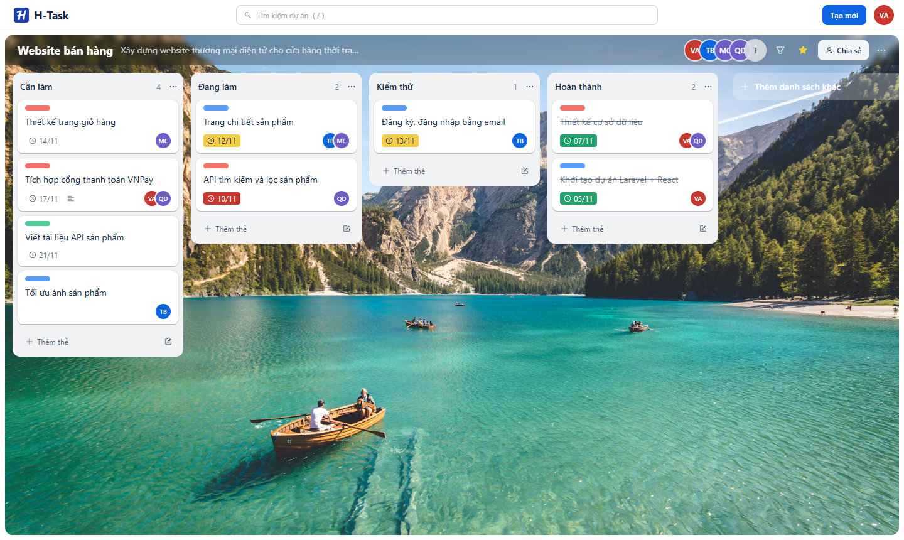

## Mục lục

- [Tính năng](#tính-năng)
- [Giao diện](#giao-diện)
- [Công nghệ](#công-nghệ)
- [Cấu trúc thư mục](#cấu-trúc-thư-mục)
- [Cài đặt và chạy ở máy](#cài-đặt-và-chạy-ở-máy)
- [Triển khai](#triển-khai)
- [API chính](#api-chính)

## Tính năng

**Bảng Kanban**
- Danh sách (cột) tuỳ chỉnh: thêm, đổi tên, xoá, kéo thả đổi thứ tự.
- Kéo thả thẻ giữa các danh sách; thứ tự thẻ được lưu lại.
- Thêm nhanh thẻ ngay trong cột; lọc thẻ theo từ khoá, độ ưu tiên hoặc chỉ thẻ của mình.
- Gắn sao bảng, tìm kiếm dự án (phím tắt `/`).
- Phông nền bảng: 12 màu gradient, 31 ảnh phong cảnh có sẵn từ Unsplash (tìm kiếm theo chủ đề) hoặc ảnh tự tải lên.

**Thẻ công việc**
- Cửa sổ chi tiết: tiêu đề, mô tả, độ ưu tiên, hạn chót, đánh dấu hoàn thành, chuyển danh sách.
- Giao nhiều thành viên cho một thẻ; xem hồ sơ hoặc gỡ thành viên khỏi thẻ.
- Bình luận và lịch sử hoạt động của thẻ hiển thị chung một dòng thời gian.

**Cộng tác**
- Mời thành viên bằng email, kể cả người **chưa có tài khoản**: người được mời nhận thư, xác minh mã 6 số, đặt họ tên và mật khẩu là vào thẳng dự án.
- Quản lý thành viên: xem lời mời đang chờ, huỷ lời mời, gỡ thành viên (đồng thời gỡ khỏi các thẻ).
- Mọi thành viên trong dự án đều tạo, sửa, giao việc được; chủ dự án quản lý thành viên.

**Cá nhân**
- *Công việc của tôi*: mọi thẻ được giao ở tất cả dự án.
- *Tổng quan*: số việc đã xong, chưa xong, quá hạn và tiến độ từng dự án.
- Nhật ký hoạt động, trang hồ sơ, đổi mật khẩu, bật/tắt email nhắc hạn.

**Tài khoản và thông báo**
- Đăng ký có xác minh email bằng mã, quên mật khẩu qua mã gửi về email.
- Xác thực API bằng token (Laravel Sanctum).
- Email nhắc việc sắp đến hạn gửi tự động lúc 8:00 mỗi sáng.

## Giao diện

### Danh sách bảng và menu tài khoản

| Bảng của bạn | Menu tài khoản |
|---|---|
| 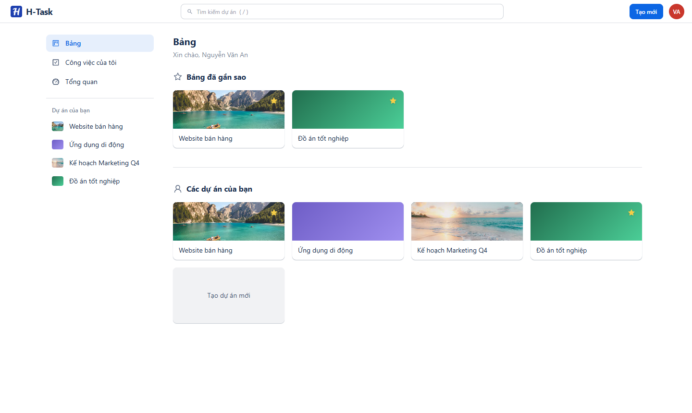 | 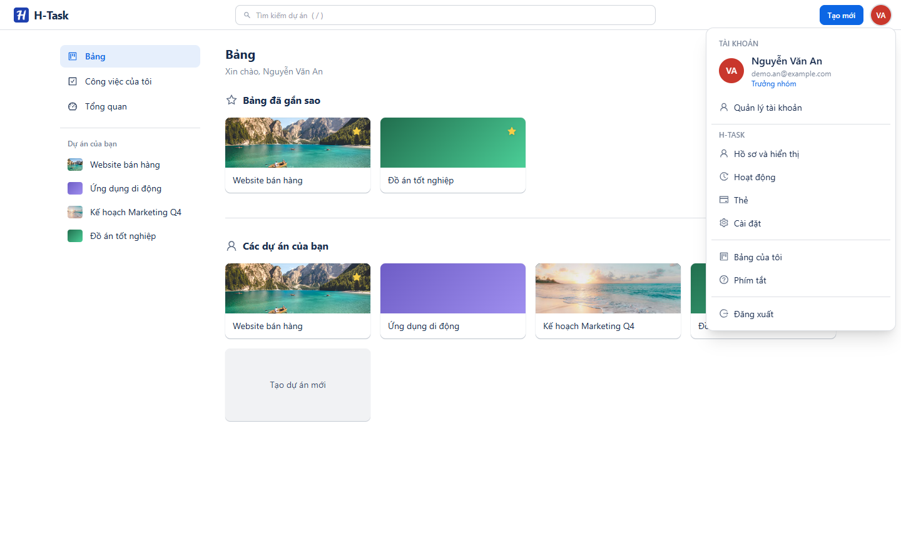 |

### Chi tiết thẻ

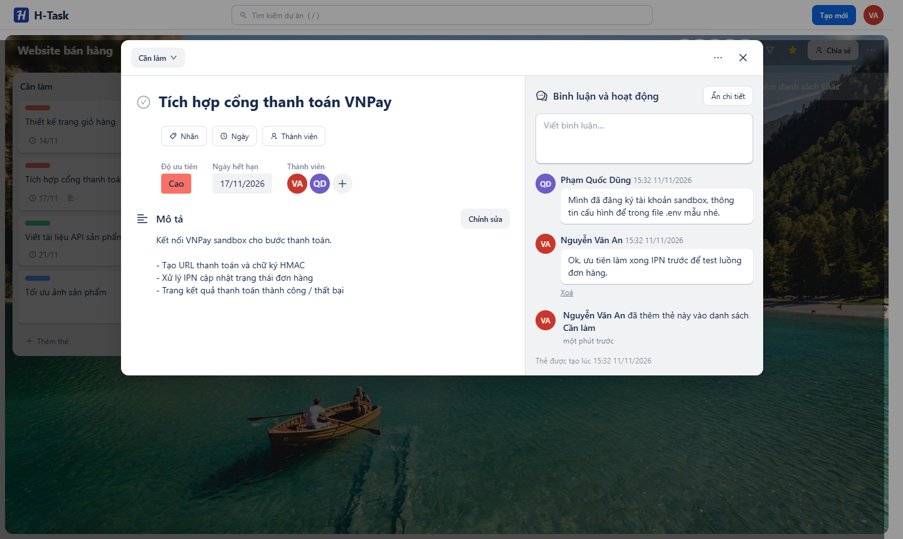

### Tạo dự án và chọn phông nền

| Tạo dự án | Ảnh nền có sẵn |
|---|---|
| 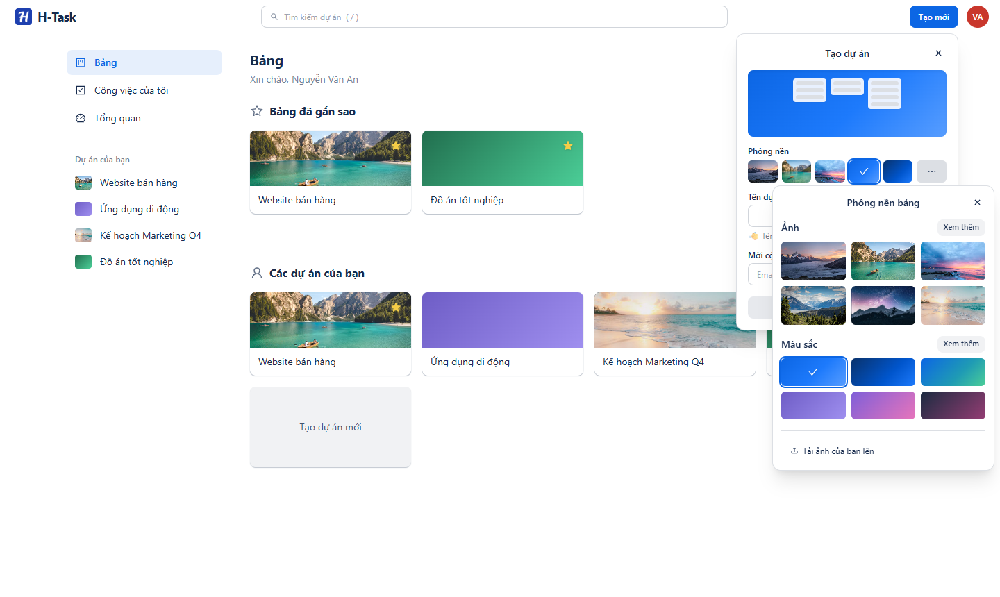 | 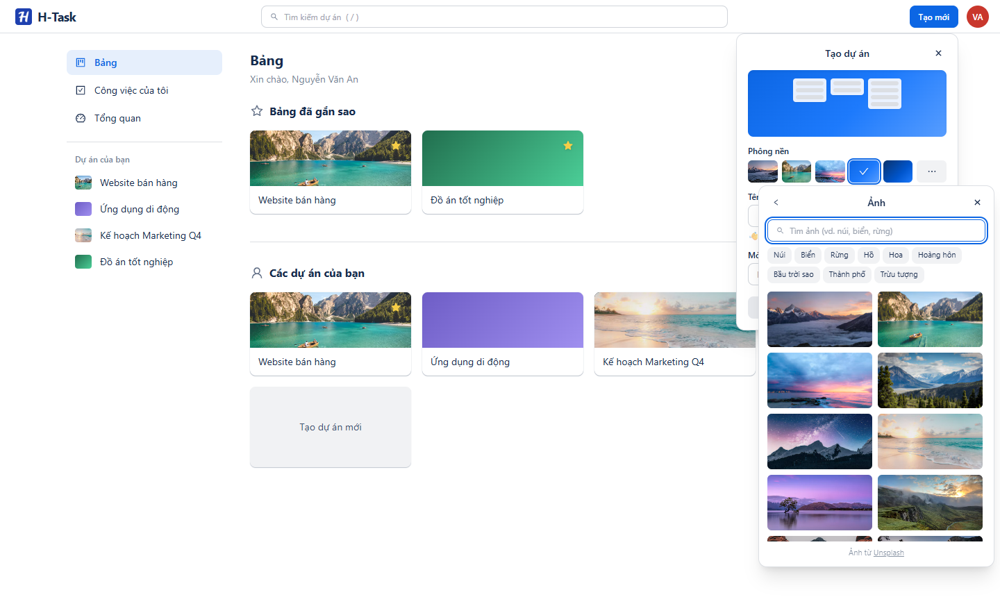 |

### Chia sẻ dự án và mời thành viên

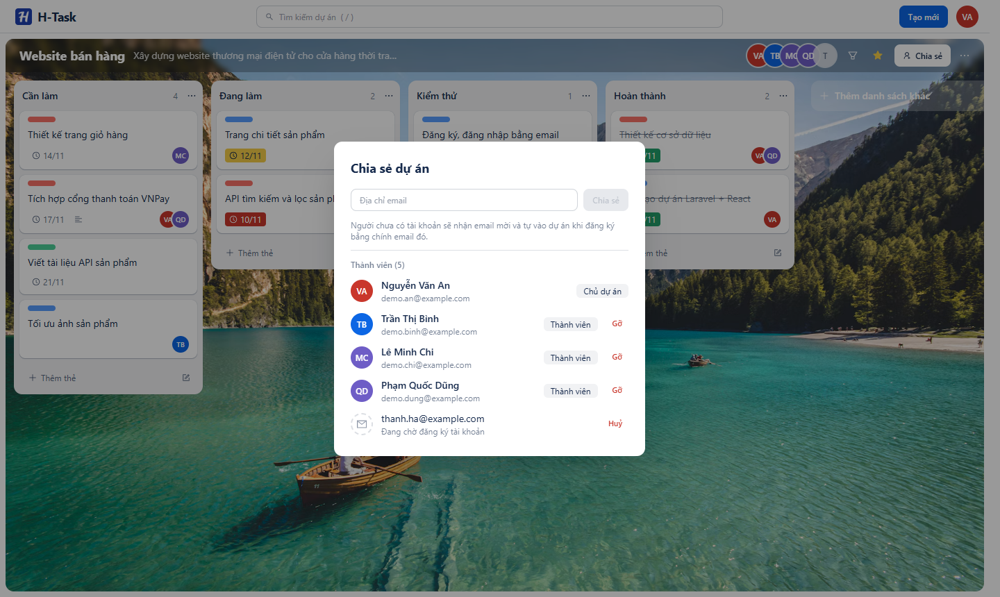

| Email mời | Trang nhận lời mời |
|---|---|
| 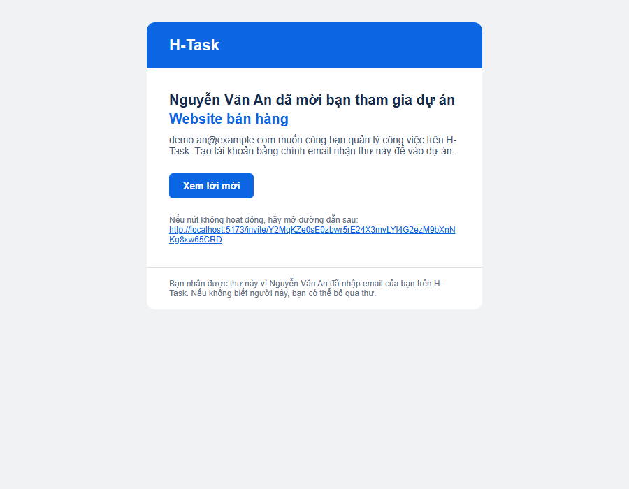 | 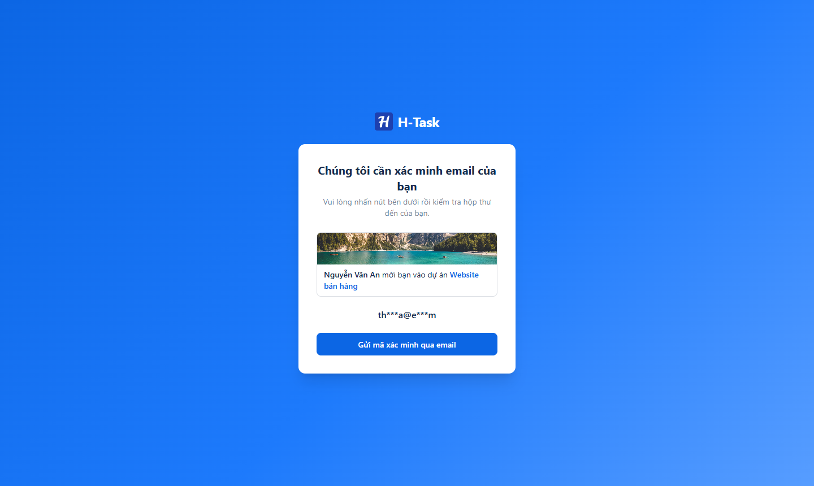 |

### Công việc của tôi và Tổng quan

| Công việc của tôi | Tổng quan |
|---|---|
| 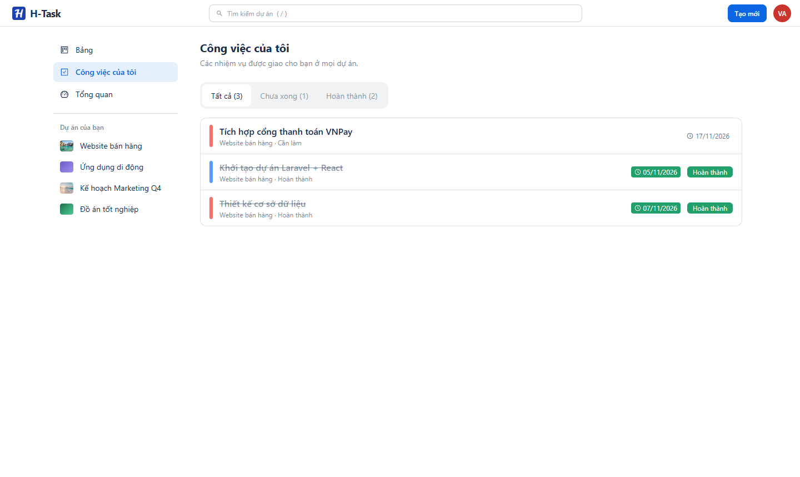 | 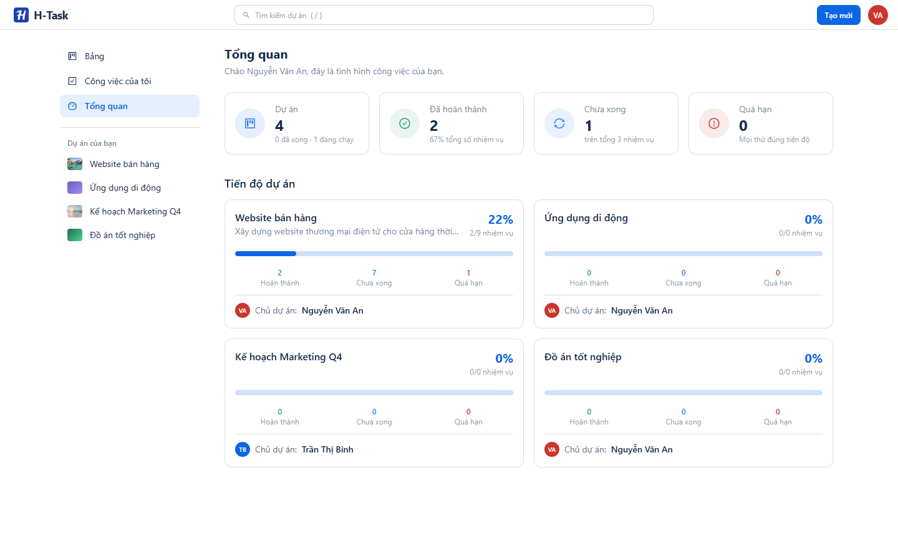 |

### Hoạt động và hồ sơ

| Nhật ký hoạt động | Hồ sơ |
|---|---|
| 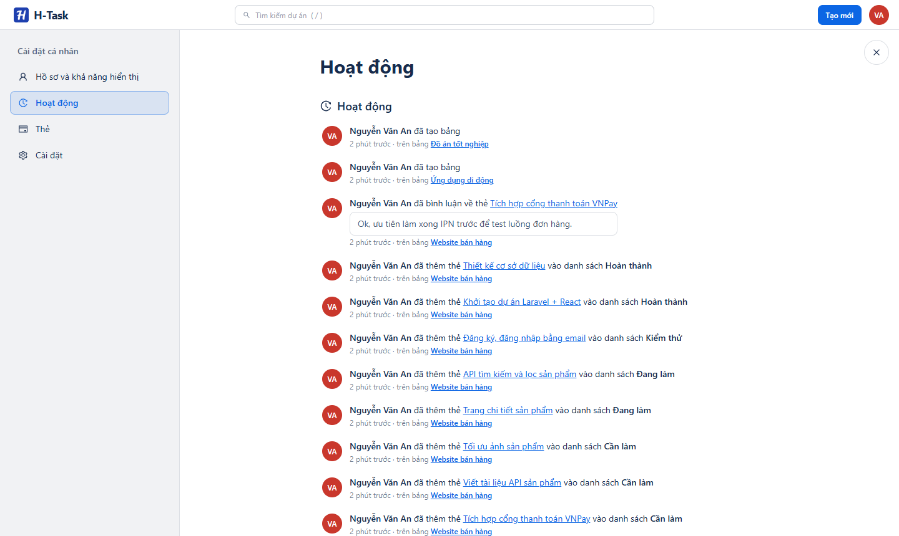 | 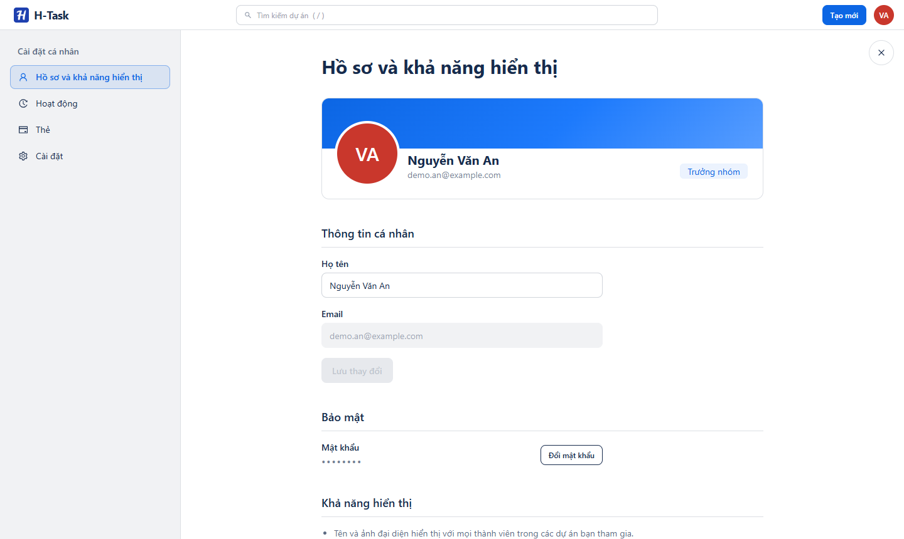 |

### Đăng nhập, đăng ký và xác minh email

| Đăng nhập | Đăng ký |
|---|---|
| 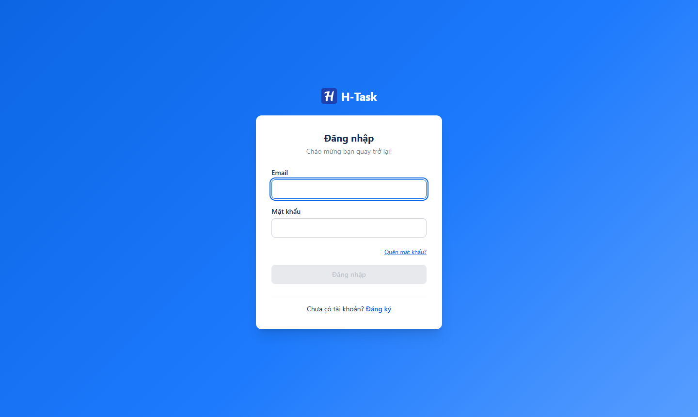 | 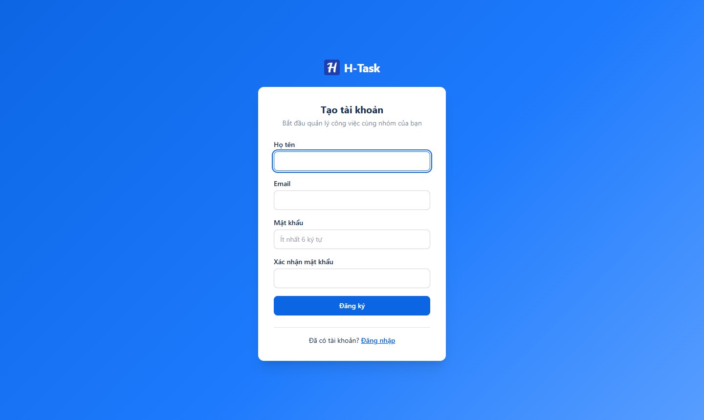 |

| Nhập mã xác minh | Email chứa mã |
|---|---|
| 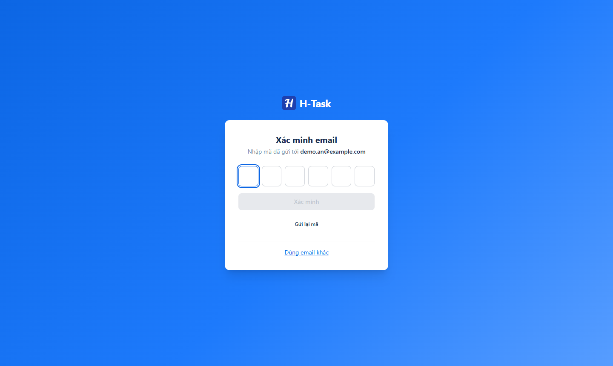 | 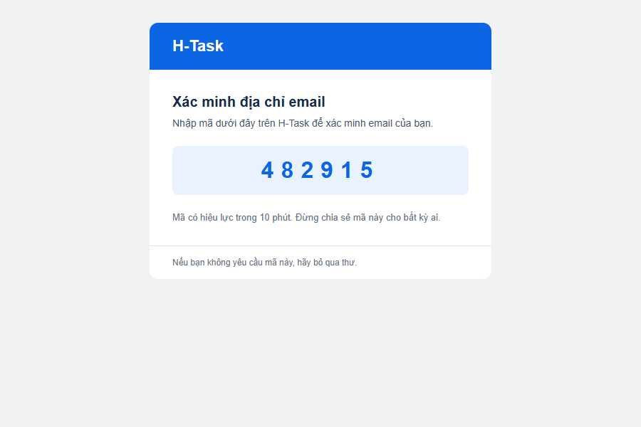 |

## Công nghệ

| Phần | Công nghệ |
|---|---|
| Frontend | React 19, TypeScript, Vite 6, React Router 6, TanStack Query 5, Tailwind CSS 3 + daisyUI 5, @hello-pangea/dnd (kéo thả), Axios |
| Backend | Laravel 12 (PHP 8.2), Laravel Sanctum, Laravel Mail + Notifications, Task Scheduling |
| Cơ sở dữ liệu | MySQL 8 |
| Triển khai | Docker trên Render (backend), Vercel (frontend) |

## Cấu trúc thư mục

```
Web_QLCVN/
├── backend/                 # Laravel API
│   ├── app/Http/Controllers # Project, Task, List, Comment, Activity, Invitation...
│   ├── app/Models           # Project, TaskList, Task, Comment, Activity, ProjectInvitation...
│   ├── database/migrations
│   ├── resources/views/emails
│   ├── routes/api.php       # Định nghĩa API
│   ├── routes/console.php   # Lịch gửi email nhắc hạn
│   ├── Dockerfile           # Image cho Render
│   └── docker/entrypoint.sh
├── frontend/                # React + Vite
│   └── src/
│       ├── api/             # Hàm gọi API theo từng nhóm
│       ├── hooks/           # React Query hooks
│       ├── components/      # tasks/, projects/, layout/, ui/...
│       ├── pages/           # Các trang (và pages/settings)
│       └── routers/router.tsx
├── flutter_app/             # Ứng dụng di động Flutter
└── assets/                  # Ảnh chụp màn hình cho README
```

## Cài đặt và chạy ở máy

### Yêu cầu

- PHP 8.2+ với các extension `pdo_mysql`, `mbstring`, `fileinfo`
- Composer 2
- Node.js 18+ và npm
- MySQL 8 (Laragon, XAMPP hoặc cài riêng)

### Backend (Laravel)

```bash
cd backend
composer install
cp .env.example .env
php artisan key:generate
```

Sửa các biến trong `backend/.env`:

```env
DB_CONNECTION=mysql
DB_HOST=127.0.0.1
DB_PORT=3306
DB_DATABASE=task_db
DB_USERNAME=root
DB_PASSWORD=

# Gửi email (ví dụ Gmail: dùng App Password, không dùng mật khẩu đăng nhập)
MAIL_MAILER=smtp
MAIL_HOST=smtp.gmail.com
MAIL_PORT=587
MAIL_USERNAME=email_cua_ban@gmail.com
MAIL_PASSWORD=app_password
MAIL_FROM_ADDRESS=email_cua_ban@gmail.com
MAIL_FROM_NAME="H-Task"

# Địa chỉ frontend, dùng cho link trong email mời
FRONTEND_URL=http://localhost:5173
```

Tạo database `task_db` trong MySQL, rồi chạy:

```bash
php artisan migrate
php artisan storage:link      # để xem được ảnh nền tải lên
php artisan serve             # http://localhost:8000
```

Muốn gửi email nhắc hạn tự động khi chạy ở máy, mở thêm một terminal:

```bash
php artisan schedule:work
```

### Frontend (React)

```bash
cd frontend
npm install
```

Tạo file `frontend/.env`:

```env
VITE_API_URL=http://localhost:8000/api
```

```bash
npm run dev                   # http://localhost:5173
```

Build bản production: `npm run build` (kiểm tra kiểu TypeScript rồi build vào `dist/`).

## Triển khai

### Backend trên Render (Docker)

1. Tạo **Web Service** từ repo GitHub, chọn runtime **Docker**, **Root Directory** là `backend`.
2. Render không có MySQL, cần một MySQL bên ngoài (ví dụ Aiven, TiDB Cloud).
3. Khai báo ở **Environment**:

   | Biến | Giá trị |
   |---|---|
   | `APP_KEY` | Kết quả của `php artisan key:generate --show` |
   | `APP_URL` | `https://<tên-service>.onrender.com` |
   | `FRONTEND_URL` | Địa chỉ frontend trên Vercel |
   | `DB_CONNECTION`, `DB_HOST`, `DB_PORT`, `DB_DATABASE`, `DB_USERNAME`, `DB_PASSWORD` | Thông tin MySQL |
   | `MYSQL_ATTR_SSL_CA` | `/etc/secrets/ca.pem` nếu MySQL bắt buộc SSL (tải CA của nhà cung cấp lên mục **Secret Files** với tên `ca.pem`) |
   | `MAIL_*` | Giống cấu hình ở máy |

Khi khởi động, container tự chạy `migrate --force`, cache cấu hình và chạy lịch gửi email nhắc hạn. Đặt `RUN_MIGRATIONS=false` hoặc `RUN_SCHEDULER=false` để tắt từng phần.

> Ổ đĩa của Render gói miễn phí không lưu lâu dài: ảnh nền người dùng tải lên sẽ mất sau mỗi lần deploy. Màu nền và ảnh Unsplash có sẵn không bị ảnh hưởng.

### Frontend trên Vercel

1. Import repo, chọn **Root Directory** là `frontend` (framework Vite).
2. Thêm biến môi trường `VITE_API_URL=https://<tên-service>.onrender.com/api`.
3. Deploy. Mọi đường dẫn được chuyển về `index.html` để React Router xử lý.

## API chính

Tất cả endpoint có tiền tố `/api`. Trừ nhóm đăng ký/đăng nhập và lời mời, các endpoint cần header `Authorization: Bearer <token>`.

| Nhóm | Endpoint |
|---|---|
| Xác thực | `POST /register`, `POST /verify-email`, `POST /resend-code`, `POST /login`, `POST /logout`, `POST /password/reset/send-code`, `POST /password/reset` |
| Tài khoản | `GET /user`, `PUT /account`, `PUT /account/password`, `PUT /account/settings` |
| Dự án | `GET/POST /projects`, `GET/PUT/DELETE /projects/{id}` |
| Thành viên | `POST /projects/{id}/members`, `DELETE /projects/{id}/members/{userId}`, `DELETE /projects/{id}/invitations/{invitationId}` |
| Lời mời | `GET /invitations/{token}`, `POST /invitations/{token}/send-code`, `/verify-code`, `/accept` |
| Danh sách | `GET/POST /projects/{id}/lists`, `PUT /projects/{id}/lists/reorder`, `PUT/DELETE /lists/{id}` |
| Thẻ | `GET/POST /projects/{id}/tasks`, `PUT/DELETE /tasks/{id}`, `PUT /tasks/{id}/move`, `GET /my-tasks` |
| Bình luận | `GET/POST /tasks/{id}/comments`, `DELETE /comments/{id}` |
| Hoạt động | `GET /activities/me`, `GET /tasks/{id}/activities`, `GET /projects/{id}/activities` |
| Khác | `GET /dashboard`, `GET/POST /backgrounds` |

## Nhóm phát triển

Dự án được thực hiện bởi nhóm sinh viên CNTT theo quy trình Agile – Scrum, nhằm rèn luyện kỹ năng làm việc nhóm và phát triển sản phẩm với các công nghệ đang được dùng thực tế.

## Giấy phép

Dự án phục vụ mục đích học tập và nghiên cứu. Không sử dụng vào mục đích thương mại khi chưa có sự đồng ý của nhóm phát triển.
